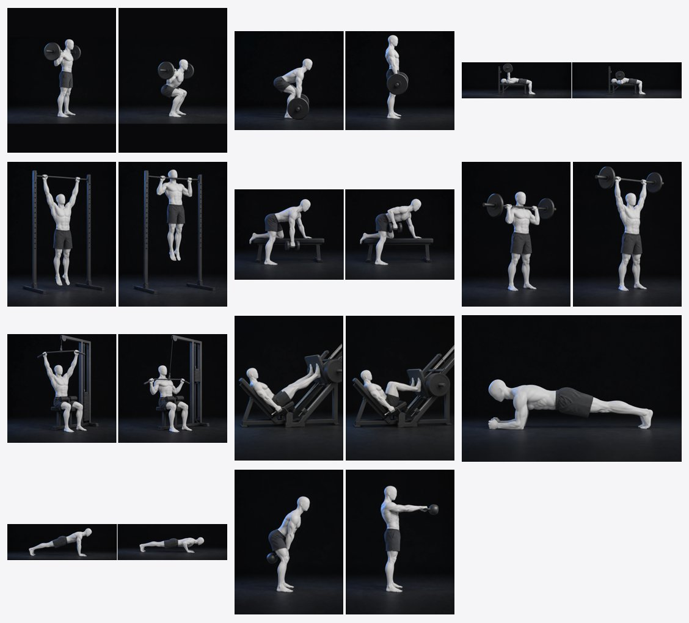

# Open Exercise Illustrations

**415 gym, home and bodyweight exercises** drawn with one consistent figure, each shown in its **start and end position**, with structured metadata: target muscles, equipment, movement pattern, difficulty and more. Free to use for anything (CC0 public domain).



> [!WARNING]
> **AI-generated illustrations. Not reviewed by a qualified coach or medical professional. Not training or medical advice.** Every image was checked by eye, but details such as grip, cable paths or machine geometry can be imperfect, and the equipment may shift slightly between the start and end frames. Check exercise form against a qualified source before showing these to people who will copy them.

## What's included

| | |
|---|---|
| Exercises | 415 (359 start→end, 45 single-image holds/stretches, 11 three-step moves) |
| Variants | 44 alternate names that reuse another exercise's images (e.g. "Military Press" → Overhead Press), some with a one-line note on how the variant differs |
| Equipment | 41 equipment types, from barbells to gym machines, cardio machines and household items |
| Images | 796 WebP files, ~24 MB total |
| Formats | `exercises.json` (full metadata) and `exercises.csv` (flat, for spreadsheets) |

Style: matte pale-grey mannequin with no face, dark knee-length shorts, dark charcoal studio background, soft blue rim light. No text, logos or watermarks.

## Folder layout

```
exercises.json        all metadata
exercises.csv         same data, one row per exercise
images/{id}/start.webp   starting position
images/{id}/end.webp     end position
images/{id}/mid.webp     only for three-step moves (start → mid → end)
images/{id}/hold.webp    only for holds and stretches (single image)
```

## Metadata (`exercises.json`)

```json
{
  "id": "leg-press",
  "name": "Leg Press",
  "aliases": [],
  "equipment": ["machine"],
  "equipmentLabel": "Leg press machine",
  "machineType": "leg-press",
  "muscles": { "primary": ["quads", "glutes"], "secondary": ["hamstrings", "core"] },
  "movementPattern": "squat",
  "category": "compound",
  "unilateral": false,
  "impact": "none",
  "level": "beginner",
  "suitableFor": ["gym", "machines"],
  "isWarmUp": false,
  "view": "side view",
  "frames": ["start", "end"],
  "images": { "start": "images/leg-press/start.webp", "end": "images/leg-press/end.webp" },
  "width": 768,
  "height": 1024
}
```

| Field | Meaning |
|---|---|
| `id` | Stable kebab-case identifier; also the image folder name. |
| `name`, `aliases` | Display name and other common names, useful for search and matching. |
| `equipment` | Equipment ids (see `equipment` list at the end of the file). Empty array = bodyweight only. |
| `equipmentLabel` | Human-readable equipment text. |
| `machineType` | Which machine, when `equipment` contains `machine` or `cardio-machine`. |
| `muscles.primary` | Main muscles worked (prime movers). |
| `muscles.secondary` | Assisting or stabilising muscles. |
| `muscles.alsoTargets` | Extra detail outside the main key set (currently only `adductors`). |
| `movementPattern` | `push-h` / `push-v` (horizontal / vertical push), `pull-h` / `pull-v`, `squat`, `hinge`, `lunge`, `carry`, `rotation`, `core`, `isometric`, `plyo`, `mobility`, `stretch`, `cardio`. |
| `category` | `compound`, `isolation`, `conditioning`, `mobility`, `stretch`. |
| `unilateral` | `true` = one side at a time. **Images show one side only** — tell users to do both sides. |
| `impact` | `none`, `low`, `high` (jumping / landing). |
| `level` | `beginner`, `intermediate`, `advanced`. |
| `suitableFor` | Where it can be done: `gym`, `machines` (machine-only gym session), `home`, `bodyweight` (no equipment). |
| `isWarmUp` | Commonly used as a warm-up drill. |
| `view` | Camera angle. |
| `frames`, `images` | Which images exist and their paths, in playback order. |
| `width`, `height` | Pixel size; every frame of one exercise has the same size. |

### Muscle keys

| Key | Muscles |
|---|---|
| `chest` | Pectorals |
| `shoulders` | Deltoids (front, side, rear) |
| `triceps` / `biceps` / `forearms` | Upper and lower arm |
| `lats` | Latissimus dorsi |
| `back` | Upper/mid back (rhomboids, mid trapezius, teres) |
| `traps` | Upper trapezius |
| `lower_back` | Spinal erectors |
| `core` | Abdominals (rectus and transverse abdominis) |
| `obliques` | Internal and external obliques |
| `glutes` | Gluteus maximus, medius, minimus |
| `quads` / `hamstrings` / `calves` | Front thigh / back thigh / lower leg |
| `tibialis` | Tibialis anterior (front of shin) |
| `neck` | Neck flexors and extensors |

### Equipment ids

`ab-wheel`, `anchor`, `backpack`, `band`, `barbell`, `battle-ropes`, `bench`, `cable`, `captains-chair`, `cardio-machine`, `decline-bench`, `doorway`, `dumbbell`, `ez-bar`, `foam-roller`, `glute-ham-developer`, `incline-bench`, `jump-rope`, `kettlebell`, `landmine`, `machine`, `medicine-ball`, `mini-band`, `parallel-bars`, `parallettes`, `plate`, `plyo-box`, `post`, `preacher-bench`, `pull-up-bar`, `roman-chair`, `smith-machine`, `squat-rack`, `stability-ball`, `step`, `suspension-trainer`, `table`, `towel`, `trap-bar`, `wall`, `wrist-roller`

## Using the images

- **Show motion without a video:** stack the frames and crossfade between them (e.g. hold each ~0.9 s, fade ~0.35 s). Frames of one exercise share the same camera and crop, so a crossfade reads as movement. Show `hold` images as a still.
- **Sizes vary** between exercises (most are 768x1024; others include 1024x768, 1536x1024, 886x886). Use "contain" fitting and the `width`/`height` fields for the aspect ratio.
- Backgrounds are dark; they sit best on dark UI or inside a rounded dark card.

```js
const data = await fetch('exercises.json').then(r => r.json());
const quadMovers = data.exercises.filter(e => e.muscles.primary.includes('quads') && e.suitableFor.includes('home'));
```

```python
import json
data = json.load(open("exercises.json"))
by_name = {n.lower(): e for e in data["exercises"] for n in [e["name"], *e["aliases"]]}
```

## Known limitations

- Made with AI image models and checked by eye — not by a coach. Some fine details are imperfect.
- Unilateral moves show one side only; walking and carrying moves use the same lead leg in both frames.
- Gym-machine parts (levers, pads, plates) can shift slightly between the start and end frames.
- Muscle tags describe typical emphasis; individual technique changes it.

## License

[CC0 1.0 Universal](https://creativecommons.org/publicdomain/zero/1.0/) — public domain. Use, modify and redistribute for any purpose, commercial included, with no attribution required (a link back is appreciated). Provided **as is, without warranty of any kind**; you are responsible for how you use and present these images.
